# CampusFlow UI Specification

This package contains the **finished, approved CampusFlow frontend** (React + JavaScript + Axios + React Router, plain CSS).
Each section below shows a screenshot of one interface, its route, the file that renders it and the data it needs.
The screenshots are the source of truth for how every screen must look.

Screenshots are in `docs/screens/`. Code is in `frontend/`. The same material, with all source code, is in `docs/CampusFlow_UI_Document.pdf`.

## Project structure

```
frontend/
├── public/
│   └── .gitkeep
├── src/
│   ├── assets/
│   │   └── .gitkeep
│   ├── components/
│   │   ├── Alert.jsx
│   │   ├── Avatar.jsx
│   │   ├── Badge.jsx
│   │   ├── BarChart.jsx
│   │   ├── Card.jsx
│   │   ├── DataTable.jsx
│   │   ├── EmptyState.jsx
│   │   ├── EventCard.jsx
│   │   ├── Field.jsx
│   │   ├── Hero.jsx
│   │   ├── MeterRow.jsx
│   │   ├── Modal.jsx
│   │   ├── PageHeader.jsx
│   │   ├── ProgressBar.jsx
│   │   ├── RingChart.jsx
│   │   ├── SearchInput.jsx
│   │   ├── Skeleton.jsx
│   │   ├── StatCard.jsx
│   │   └── Tabs.jsx
│   ├── context/
│   │   └── AuthContext.jsx
│   ├── data/
│   │   └── demoData.js
│   ├── hooks/
│   │   └── .gitkeep
│   ├── layouts/
│   │   ├── AppLayout.jsx
│   │   ├── AuthLayout.jsx
│   │   ├── Sidebar.jsx
│   │   └── Topbar.jsx
│   ├── pages/
│   │   ├── admin/
│   │   │   ├── AdminDashboard.jsx
│   │   │   ├── UserManagement.jsx
│   │   │   └── Venues.jsx
│   │   ├── auth/
│   │   │   ├── Login.jsx
│   │   │   └── Register.jsx
│   │   ├── faculty/
│   │   │   ├── FacultyDashboard.jsx
│   │   │   └── ManageAttendance.jsx
│   │   ├── placement/
│   │   │   ├── DriveManagement.jsx
│   │   │   └── PlacementDashboard.jsx
│   │   ├── shared/
│   │   │   ├── AIAssistant.jsx
│   │   │   ├── Assignments.jsx
│   │   │   ├── Courses.jsx
│   │   │   ├── EventDetails.jsx
│   │   │   ├── Events.jsx
│   │   │   ├── Notifications.jsx
│   │   │   ├── Profile.jsx
│   │   │   └── SearchResults.jsx
│   │   └── student/
│   │       ├── Attendance.jsx
│   │       ├── Placements.jsx
│   │       ├── Results.jsx
│   │       ├── Skills.jsx
│   │       └── StudentDashboard.jsx
│   ├── routes/
│   │   ├── ProtectedRoute.jsx
│   │   └── routes.jsx
│   ├── services/
│   │   ├── api.js
│   │   ├── assistantService.js
│   │   ├── authService.js
│   │   └── searchService.js
│   ├── styles/
│   │   ├── auth.css
│   │   ├── components.css
│   │   ├── global.css
│   │   ├── layout.css
│   │   └── pages.css
│   ├── utils/
│   │   ├── format.js
│   │   └── navConfig.js
│   ├── App.jsx
│   └── main.jsx
├── .env.example
├── .gitignore
├── index.html
├── package.json
└── vite.config.js
```

## How the frontend is built

- **Routes:** `src/routes/routes.jsx`. Public: `/login`, `/register`. Protected by role: `/student/*`, `/faculty/*`, `/placement/*`, `/admin/*`.
- **Layouts:** `AuthLayout` (split-screen login/register) and `AppLayout` (sidebar + top bar + content). The sidebar links per role are in `src/utils/navConfig.js`.
- **Auth:** `AuthContext` stores `{ token, user }` in localStorage under `campusflow_session`. `src/services/api.js` is the single Axios instance (adds the Bearer token, redirects to /login on 401).
- **Styling:** all design tokens are CSS variables in `src/styles/global.css`. Do not add inline colors or new styling systems.
- **Demo data:** every page imports sample records from `src/data/demoData.js`. Each import is marked with a `// replace with GET ...` comment where it is used. Replace them with calls through `src/services/` files. Keep the record field names below so the markup does not change.
- **Demo mode:** set `VITE_DEMO_MODE=true` in `.env` to preview every role without a backend (log in with an email starting with student, faculty, placement or admin). Keep it `false` once the backend is connected.

## Record shapes used by the UI (field names to return from the API)

- `student`: { name, email, phone, department, program, studentId, academicYear, semester }
- `courses` (list of): { id, code, name, department, credits, semester, faculty, academicYear, description }
- `assignments` (list of): { id, title, course, due, maxMarks, status, marks, submitted, total }
- `attendanceByCourse` (list of): { course, attended, total, percent }
- `attendanceHistory` (list of): { id, date, course, status }
- `results` (list of): { id, assessment, course, marks, total, grade }
- `semesterGpa` (list of): { label, value }
- `nextActions` (list of): { id, title, hint, badge, tone, to }
- `progress` (list of): { label, value }
- `skills` (list of): { name, level, target }
- `skillGaps`: list of strings
- `recommendedPractice` (list of): { id, title, hint, badge }
- `learningPath` (list of): { step, topic, state }
- `readinessFactors` (list of): { label, value, weight }
- `drives` (list of): { id, company, role, date, deadline, minCgpa, minAttendance, departments, skills[], registered, eligible, reason }
- `eligibleStudents` (list of): { id, name, roll, department, cgpa, readiness }
- `venues` (list of): { id, name, building, floor, room, description, capacity }
- `events` (list of): { id, title, category, date, start, end, venue, building, floor, room, department, eligibility, deadline, total, registered, approval, description }
- `eventCategories`: list of strings
- `notifications` (list of): { id, type, title, message, time, unread }
- `users` (list of): { id, name, email, role, department, status }
- `classRoster` (list of): { id, name, roll }
- `facultyStats`: { performance[], insights[], schedule[], toReview[] }
- `placementStats`: { readinessBands[], registrationsByDrive[], skillDemand[], activity[] }
- `adminStats`: { usage[], departmentUsage[], alerts[], activity[] }
- `chatSeed` (list of): { id, from, text }

Notes: dates are ISO strings (YYYY-MM-DD). `status` values for assignments: PENDING, IN_PROGRESS, SUBMITTED, GRADED. Event `approval`: APPROVED or PENDING. Roles: STUDENT, FACULTY, PLACEMENT_OFFICER, ADMIN.

## Screens

### 1. Login

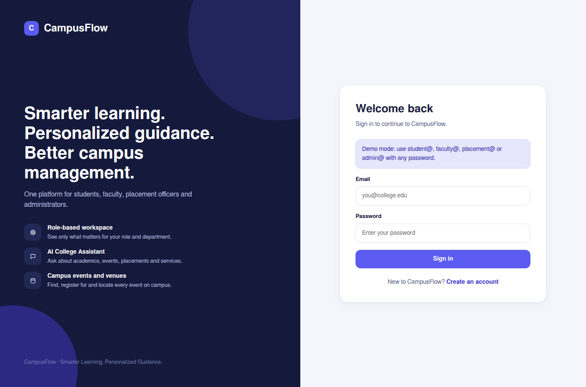

- **Route:** `/login`
- **Role:** Public
- **Page file:** `frontend/src/pages/auth/Login.jsx`
- **Data needed:**
  - `POST /api/auth/login  ->  { token, user:{id,name,email,role,department} }`
- **Behaviour:** Validates email and password, shows API errors and the session-expired notice, then redirects by role (STUDENT /student, FACULTY /faculty, PLACEMENT_OFFICER /placement, ADMIN /admin).

### 2. Register (student)

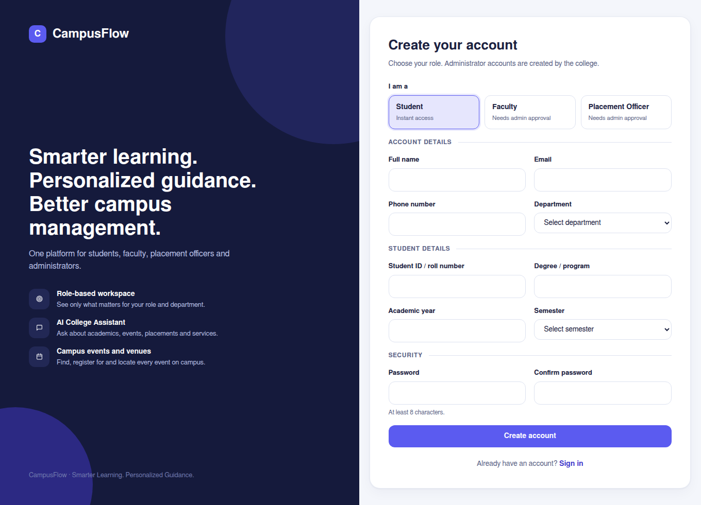

- **Route:** `/register`
- **Role:** Public
- **Page file:** `frontend/src/pages/auth/Register.jsx`
- **Data needed:**
  - `POST /api/auth/register`
- **Behaviour:** Public self-registration for STUDENT only. Fields: name, email, phone, department, password, studentId, program, academicYear, semester. Duplicate email and student ID must be rejected by the backend.

### 3. Register (faculty, role-specific fields)

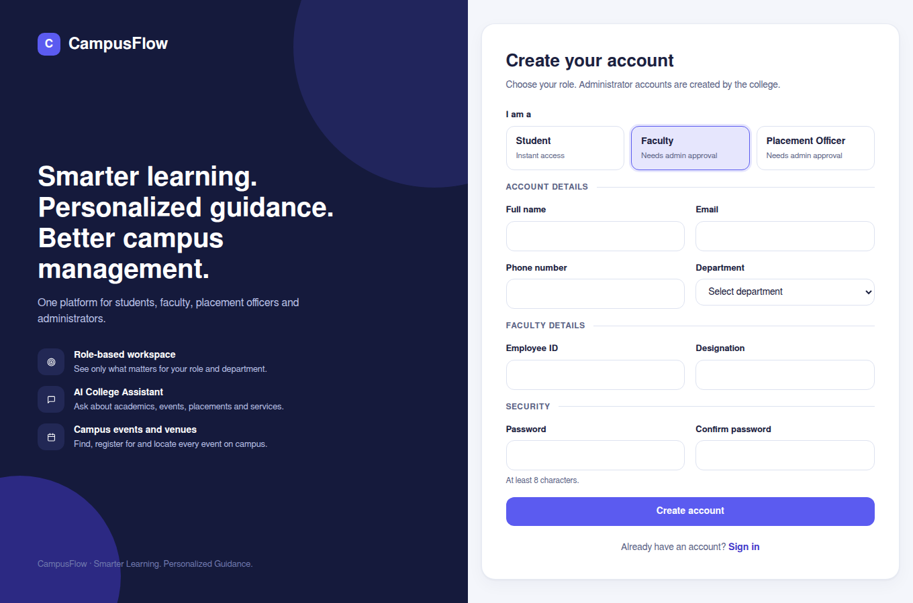

- **Route:** `/register`
- **Role:** Public
- **Page file:** `frontend/src/pages/auth/Register.jsx`
- **Data needed:**
  - `POST /api/auth/register`
- **Behaviour:** Faculty and Placement Officer registrations are created as PENDING and cannot sign in until an admin approves them. Role-specific fields change with the selected role. There is no ADMIN option.

### 4. Student dashboard

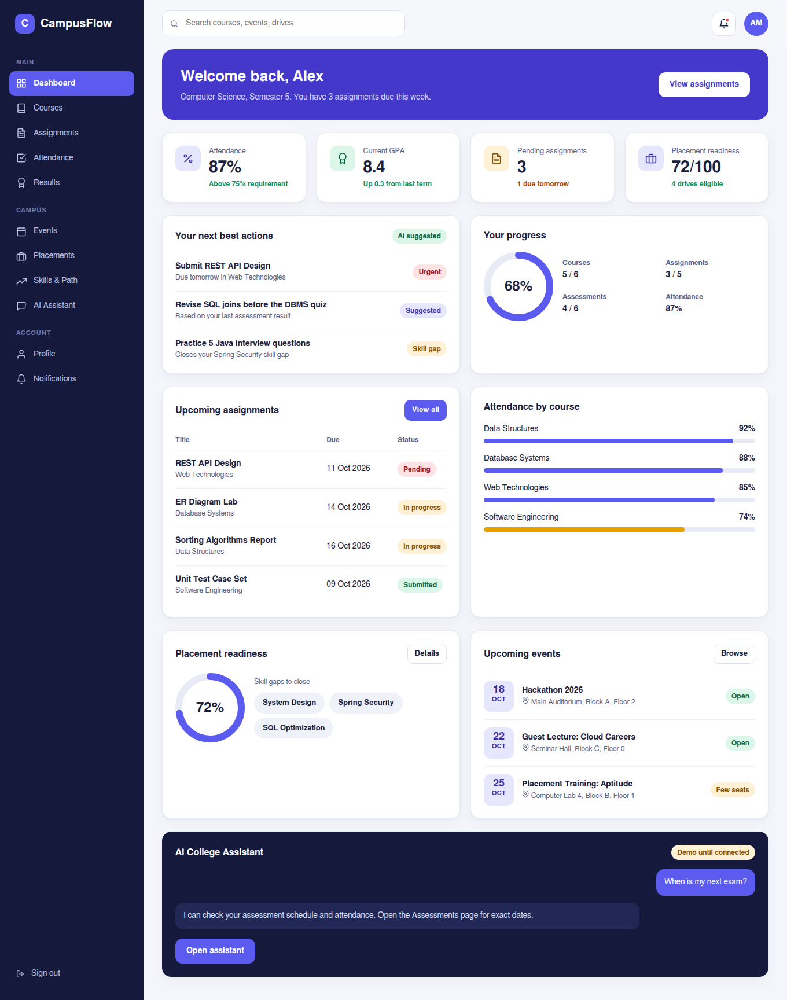

- **Route:** `/student`
- **Role:** STUDENT
- **Page file:** `frontend/src/pages/student/StudentDashboard.jsx`
- **Data needed:**
  - `GET /api/student/dashboard  ->  summary (attendance %, GPA, pending assignments, readiness score), nextActions[], progress, upcoming assignments, attendance by course, skill gaps, upcoming events`
- **Behaviour:** All numbers are computed by the backend from stored data. Show empty states when a student has no records.

### 5. Courses (student view)

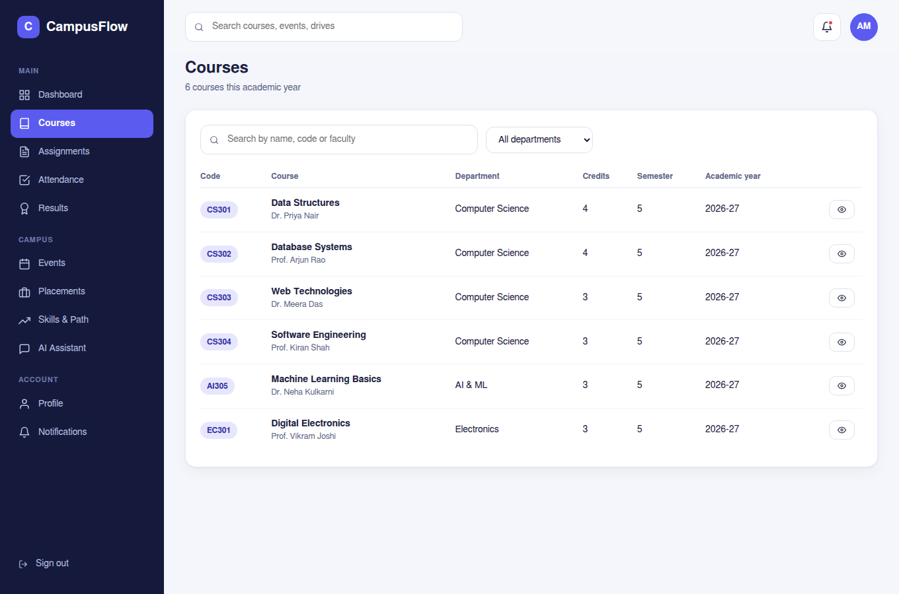

- **Route:** `/student/courses`
- **Role:** STUDENT
- **Page file:** `frontend/src/pages/shared/Courses.jsx`
- **Data needed:**
  - `GET /api/courses?search=&department=`
- **Behaviour:** Read-only for students (no Add/Edit/Delete buttons).

### 6. Assignments (student)

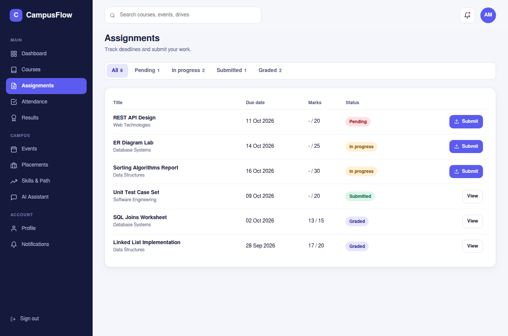

- **Route:** `/student/assignments`
- **Role:** STUDENT
- **Page file:** `frontend/src/pages/shared/Assignments.jsx`
- **Data needed:**
  - `GET /api/assignments/me`
  - `POST /api/assignments/{id}/submissions`
- **Behaviour:** Tabs filter by status. Submit opens the submission flow for pending or in-progress work.

### 7. Attendance (student)

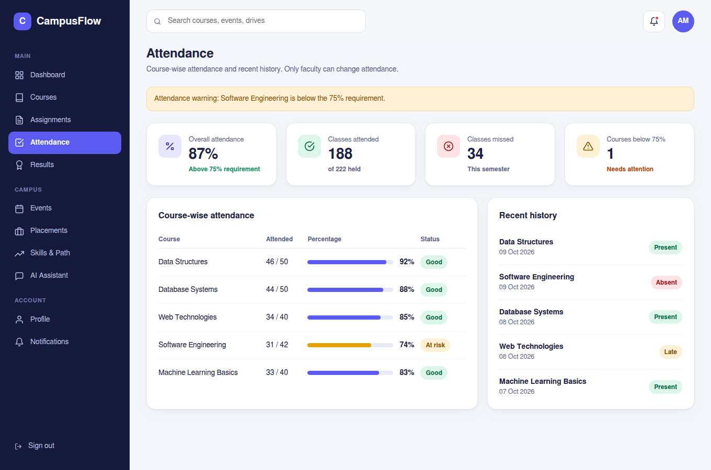

- **Route:** `/student/attendance`
- **Role:** STUDENT
- **Page file:** `frontend/src/pages/student/Attendance.jsx`
- **Data needed:**
  - `GET /api/attendance/me/summary`
  - `GET /api/attendance/me/history`
- **Behaviour:** View only. Students can never edit attendance. Courses under 75% show the warning banner.

### 8. Results

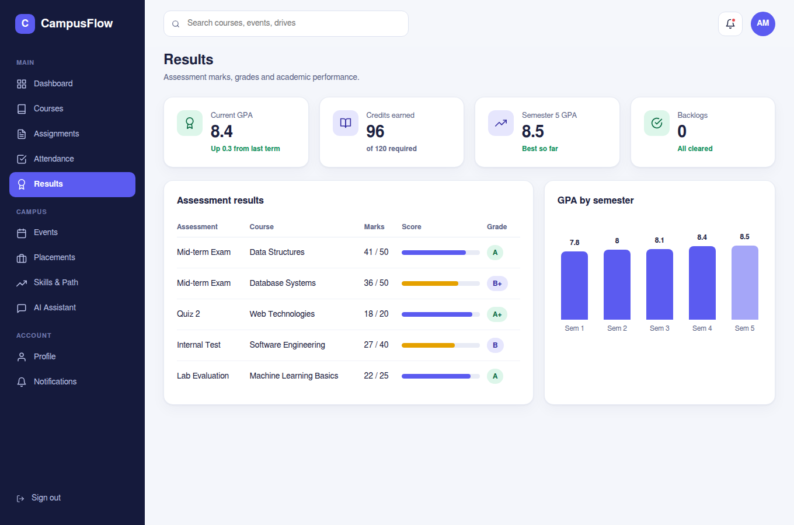

- **Route:** `/student/results`
- **Role:** STUDENT
- **Page file:** `frontend/src/pages/student/Results.jsx`
- **Data needed:**
  - `GET /api/results/me`
  - `GET /api/results/me/gpa-by-semester`
- **Behaviour:** View only.

### 9. Skills and learning path

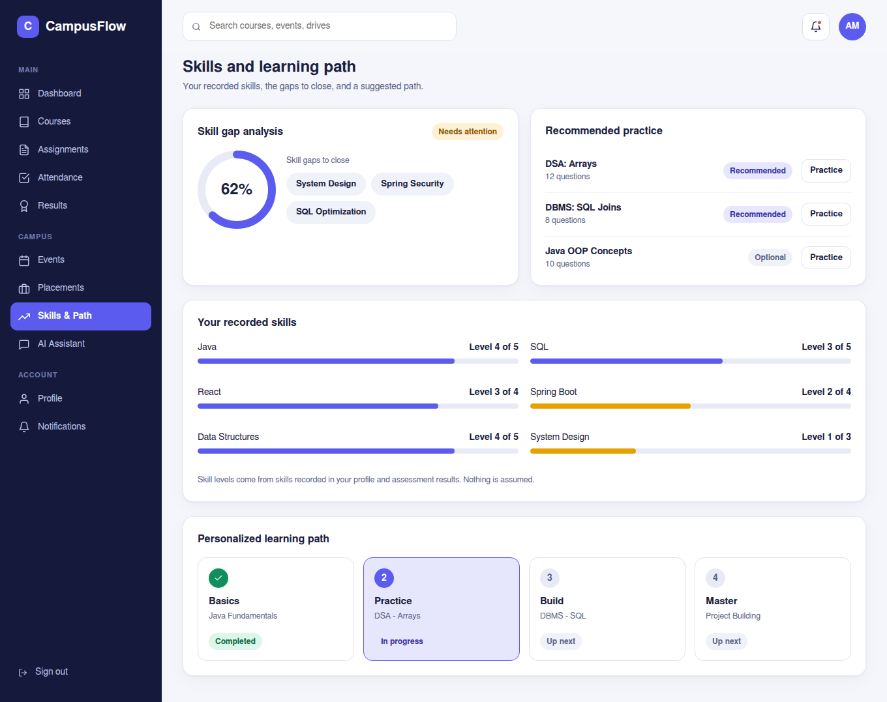

- **Route:** `/student/skills`
- **Role:** STUDENT
- **Page file:** `frontend/src/pages/student/Skills.jsx`
- **Data needed:**
  - `GET /api/skills/me`
  - `GET /api/skills/me/gaps`
  - `GET /api/learning-path/me`
  - `GET /api/recommendations/practice`
- **Behaviour:** Rule-based Java logic only. Shows only recorded skills, never invented achievements.

### 10. Placements (student)

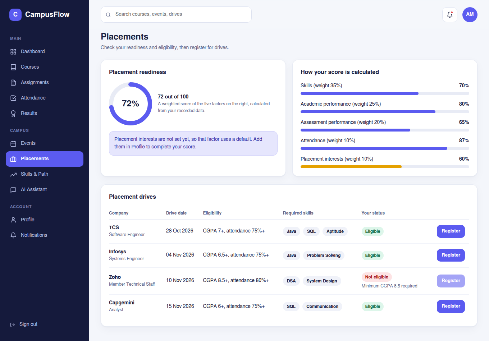

- **Route:** `/student/placements`
- **Role:** STUDENT
- **Page file:** `frontend/src/pages/student/Placements.jsx`
- **Data needed:**
  - `GET /api/placements/readiness/me  ->  score, factors[{label,value,weight}], missingData[]`
  - `GET /api/placements/drives  ->  each drive includes eligible:boolean and reason`
  - `POST /api/placements/drives/{id}/register`
- **Behaviour:** The card "How your score is calculated" must reflect the real weights used by the backend and list missing data.

### 11. Campus events (list)

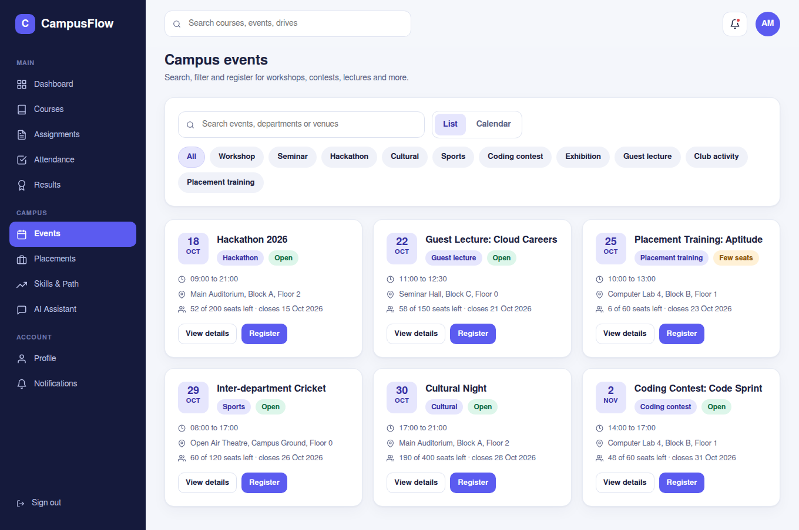

- **Route:** `/student/events`
- **Role:** STUDENT, FACULTY, PLACEMENT_OFFICER, ADMIN (view); register is STUDENT
- **Page file:** `frontend/src/pages/shared/Events.jsx`
- **Data needed:**
  - `GET /api/events?search=&category=`
  - `POST /api/events/{id}/register`
- **Behaviour:** Search box, category chips and List/Calendar toggle. Backend blocks duplicate registration, registration after the deadline, and full events.

### 12. Campus events (calendar view)

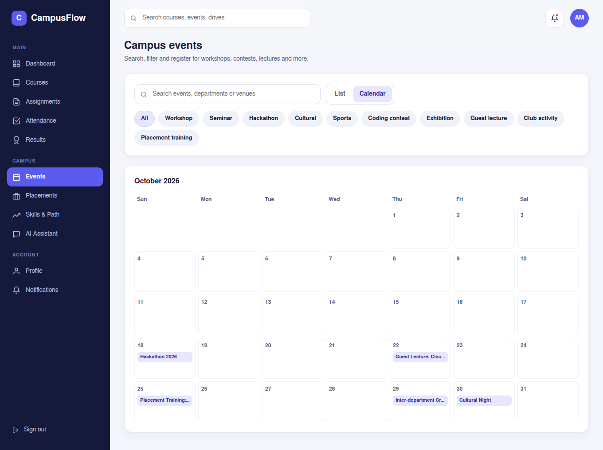

- **Route:** `/student/events`
- **Role:** Same as events list
- **Page file:** `frontend/src/pages/shared/Events.jsx`
- **Data needed:**
  - `GET /api/events?search=&category=`
- **Behaviour:** Calendar view of the same data. Month is currently fixed to October 2026 in the demo: make it follow the current month with previous/next controls only if asked.

### 13. Event details

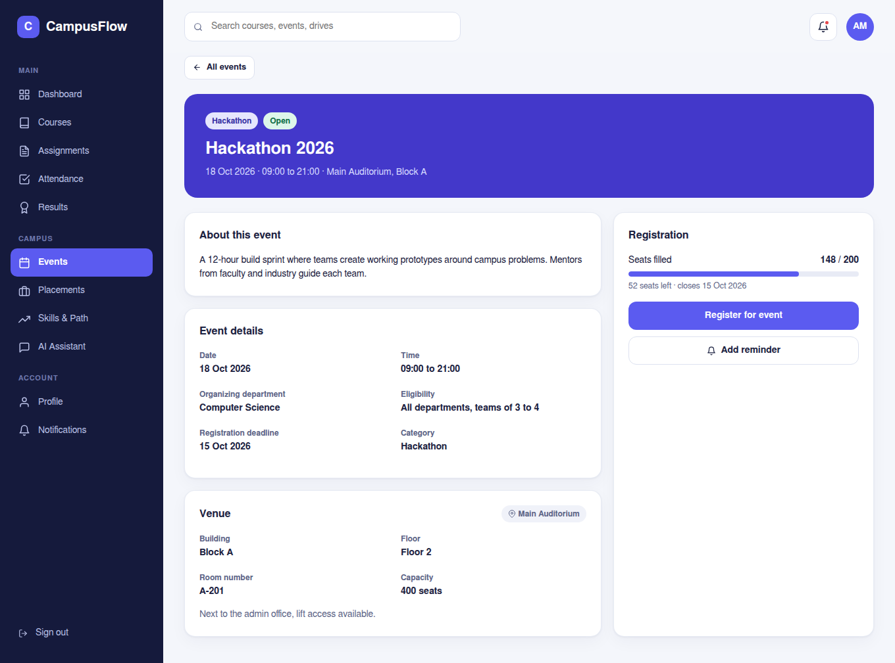

- **Route:** `/student/events/:id`
- **Role:** All logged-in roles
- **Page file:** `frontend/src/pages/shared/EventDetails.jsx`
- **Data needed:**
  - `GET /api/events/{id}`
  - `POST /api/events/{id}/register`
  - `DELETE /api/events/{id}/register`
  - `POST /api/events/{id}/reminder`
- **Behaviour:** Shows full venue breakdown (building, floor, room, capacity, description).

### 14. Notifications

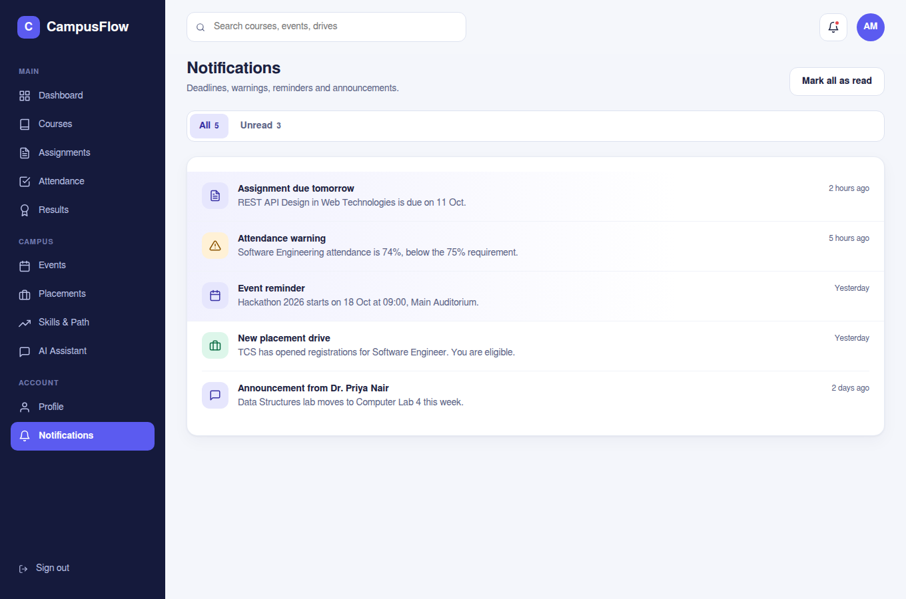

- **Route:** `/student/notifications`
- **Role:** All logged-in roles
- **Page file:** `frontend/src/pages/shared/Notifications.jsx`
- **Data needed:**
  - `GET /api/notifications`
  - `PATCH /api/notifications/read-all`
- **Behaviour:** In-app notifications. Types: assignment, attendance, event, placement, announcement.

### 15. AI College Assistant

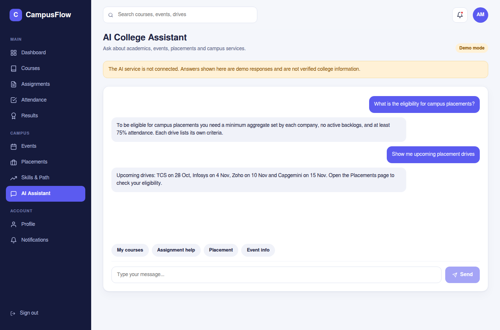

- **Route:** `/student/assistant`
- **Role:** All logged-in roles
- **Page file:** `frontend/src/pages/shared/AIAssistant.jsx`
- **Data needed:**
  - `POST /api/assistant/chat  { message }  ->  { reply, mode: "LIVE" | "DEMO" }`
- **Behaviour:** Starts empty when wired (remove chatSeed). When mode is DEMO the page shows a Demo badge and warning: never present demo replies as verified college information.

### 16. Profile

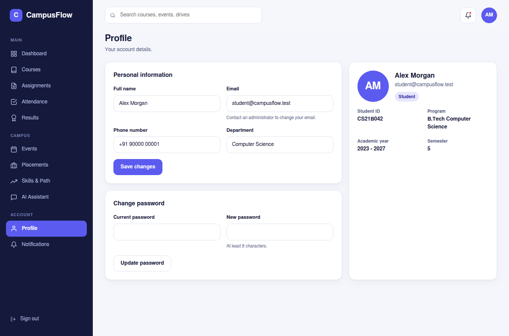

- **Route:** `/student/profile`
- **Role:** All logged-in roles
- **Page file:** `frontend/src/pages/shared/Profile.jsx`
- **Data needed:**
  - `GET /api/users/me`
  - `PUT /api/users/me`
  - `PUT /api/users/me/password`
- **Behaviour:** Email is read-only. Student-only details appear for STUDENT.

### 17. Global search results

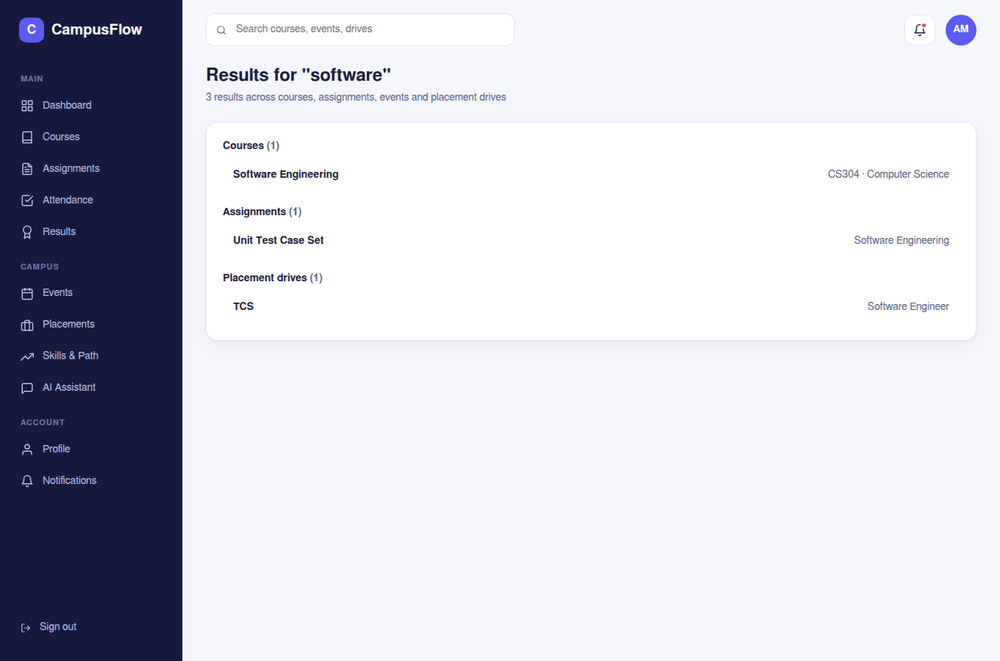

- **Route:** `/student/search?q=software`
- **Role:** All logged-in roles
- **Page file:** `frontend/src/pages/shared/SearchResults.jsx`
- **Data needed:**
  - `GET /api/search?q=  ->  { courses[], assignments[], events[], drives[] } each item {id,title,subtitle}`
- **Behaviour:** Opened from the top-bar search box. Already has loading, error and no-results states. Results must respect the caller role.

### 18. Faculty dashboard

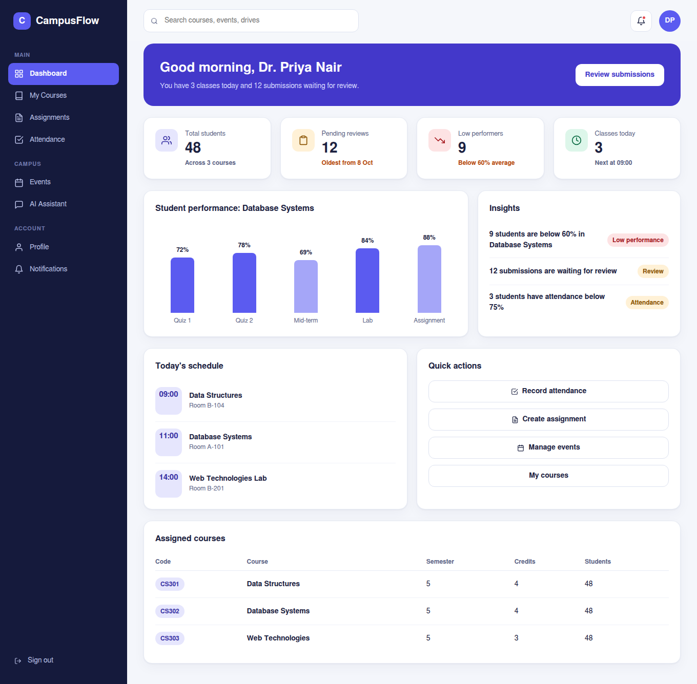

- **Route:** `/faculty`
- **Role:** FACULTY
- **Page file:** `frontend/src/pages/faculty/FacultyDashboard.jsx`
- **Data needed:**
  - `GET /api/faculty/dashboard`
- **Behaviour:** Stats, performance chart, insights, schedule and assigned courses come from stored data.

### 19. Assignments (faculty)

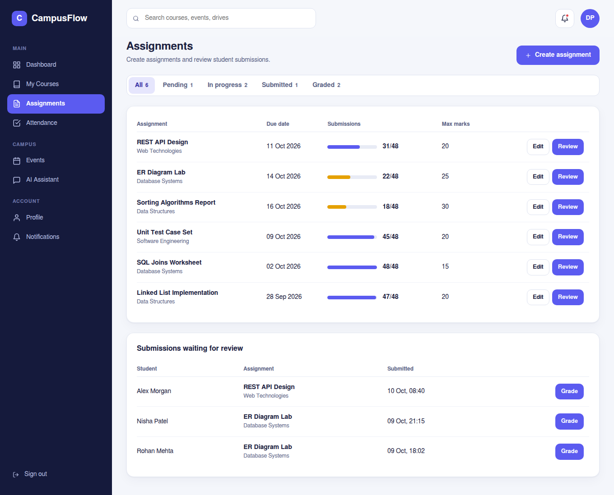

- **Route:** `/faculty/assignments`
- **Role:** FACULTY
- **Page file:** `frontend/src/pages/shared/Assignments.jsx`
- **Data needed:**
  - `GET /api/assignments?mine=true`
  - `POST /api/assignments`
  - `PUT /api/assignments/{id}`
  - `GET /api/assignments/submissions?status=SUBMITTED`
  - `PUT /api/submissions/{id}/grade`
- **Behaviour:** Same page file as the student screen, rendered with mode="faculty".

### 20. Record attendance (faculty)

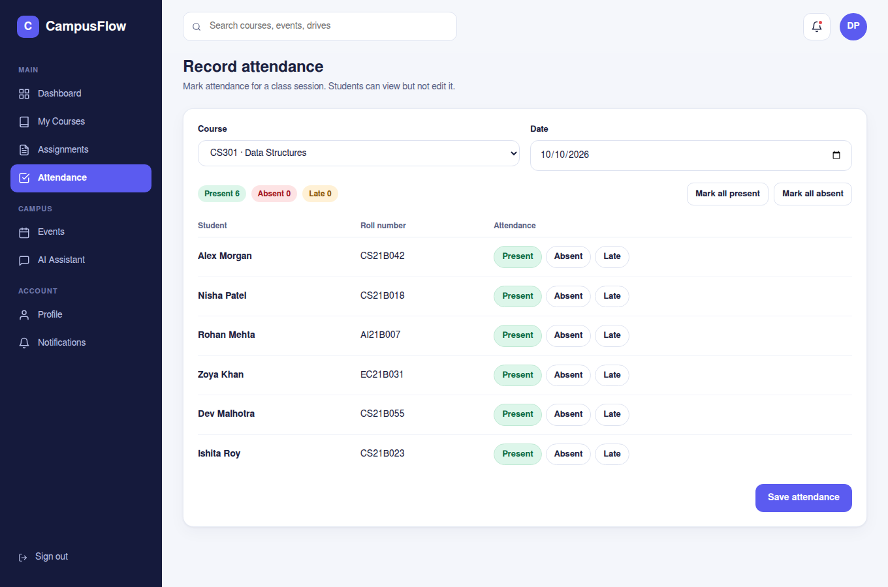

- **Route:** `/faculty/attendance`
- **Role:** FACULTY
- **Page file:** `frontend/src/pages/faculty/ManageAttendance.jsx`
- **Data needed:**
  - `GET /api/courses/{id}/students`
  - `POST /api/attendance  { courseId, date, records:[{studentId,status}] }`
- **Behaviour:** Only faculty of the course (or admin) may record attendance.

### 21. Placement officer dashboard

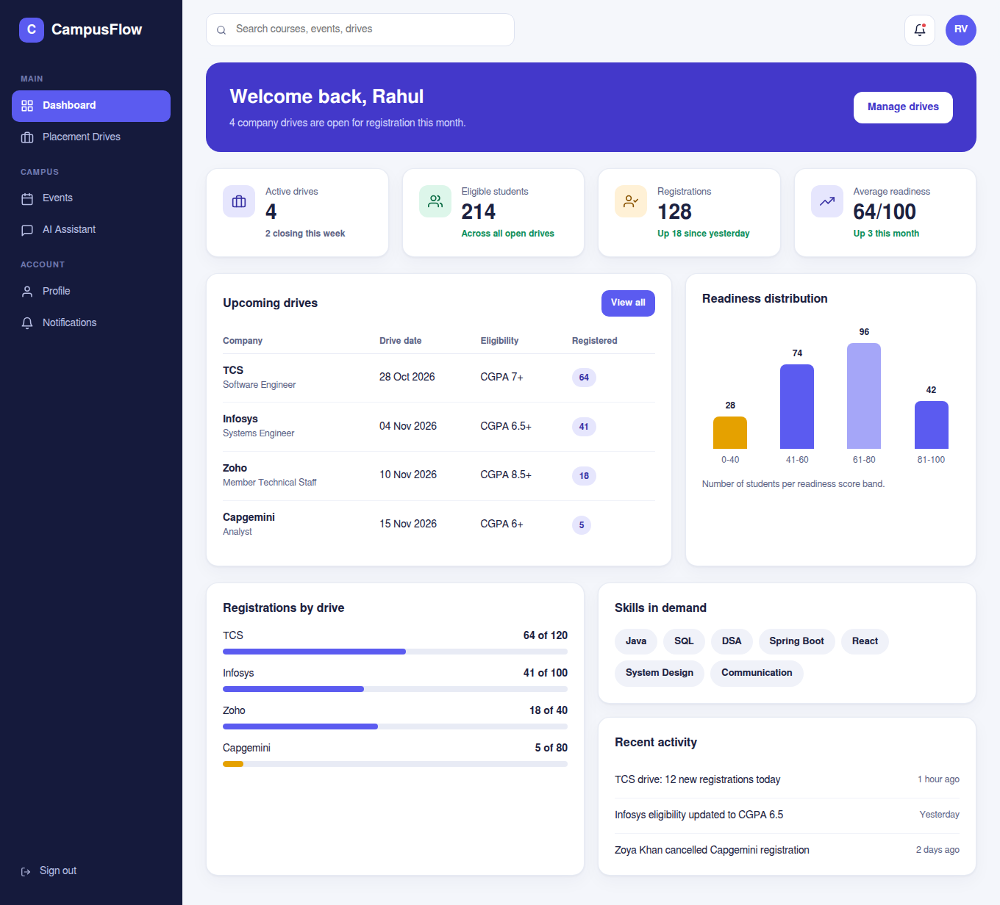

- **Route:** `/placement`
- **Role:** PLACEMENT_OFFICER
- **Page file:** `frontend/src/pages/placement/PlacementDashboard.jsx`
- **Data needed:**
  - `GET /api/placements/dashboard`
- **Behaviour:** Active drives, eligible students, registrations, readiness distribution, skills in demand, recent activity.

### 22. Placement drive management

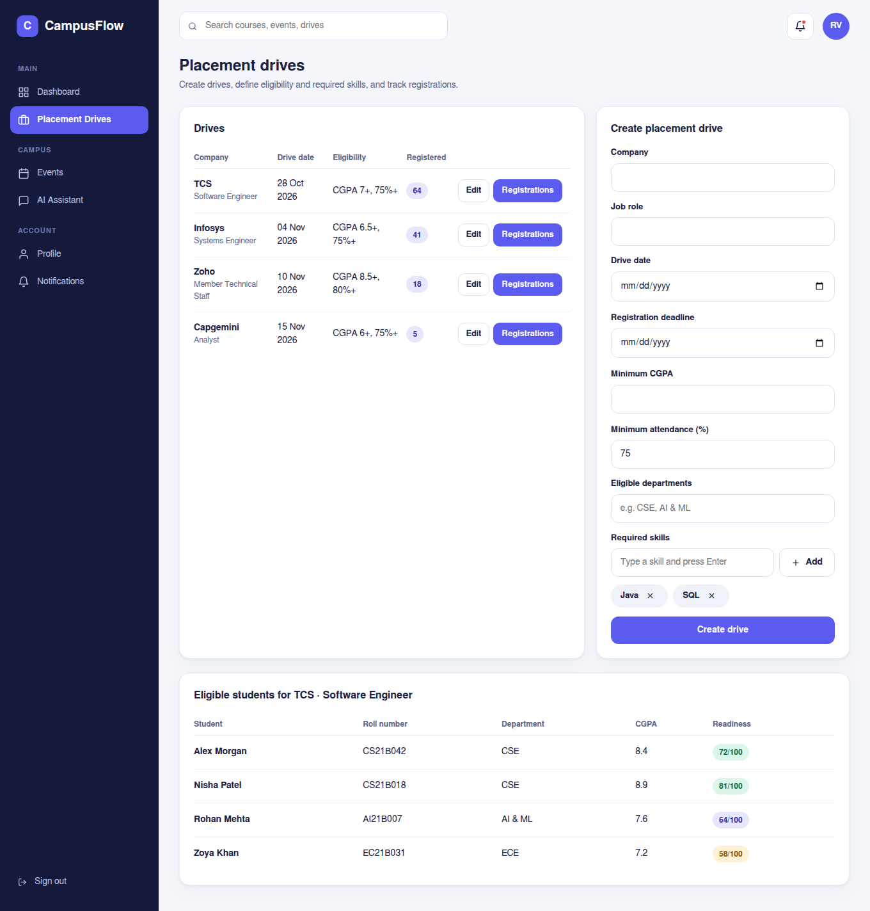

- **Route:** `/placement/drives`
- **Role:** PLACEMENT_OFFICER
- **Page file:** `frontend/src/pages/placement/DriveManagement.jsx`
- **Data needed:**
  - `GET /api/placements/drives`
  - `POST /api/placements/drives`
  - `PUT /api/placements/drives/{id}`
  - `GET /api/placements/drives/{id}/eligible-students`
  - `GET /api/placements/drives/{id}/registrations`
- **Behaviour:** Create form validates the deadline is on or before the drive date.

### 23. Administrator dashboard

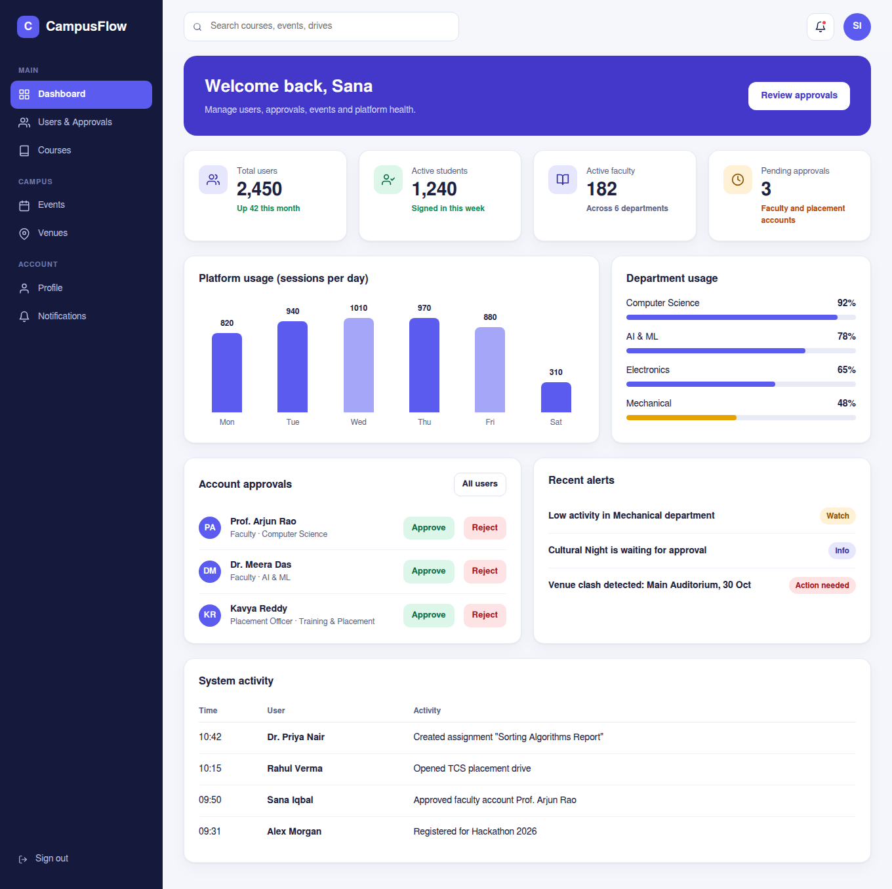

- **Route:** `/admin`
- **Role:** ADMIN
- **Page file:** `frontend/src/pages/admin/AdminDashboard.jsx`
- **Data needed:**
  - `GET /api/admin/dashboard`
  - `PATCH /api/admin/users/{id}/approve`
  - `PATCH /api/admin/users/{id}/reject`
- **Behaviour:** Approve and Reject act on pending faculty and placement accounts.

### 24. Users and approvals

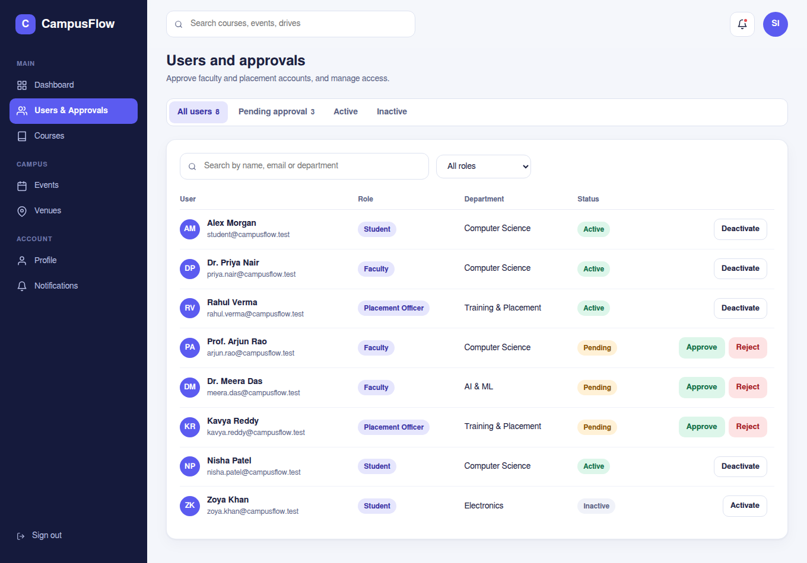

- **Route:** `/admin/users`
- **Role:** ADMIN
- **Page file:** `frontend/src/pages/admin/UserManagement.jsx`
- **Data needed:**
  - `GET /api/admin/users?status=&role=&search=`
  - `PATCH /api/admin/users/{id}/status`
- **Behaviour:** Tabs: All, Pending approval, Active, Inactive.

### 25. Course management (add course dialog)

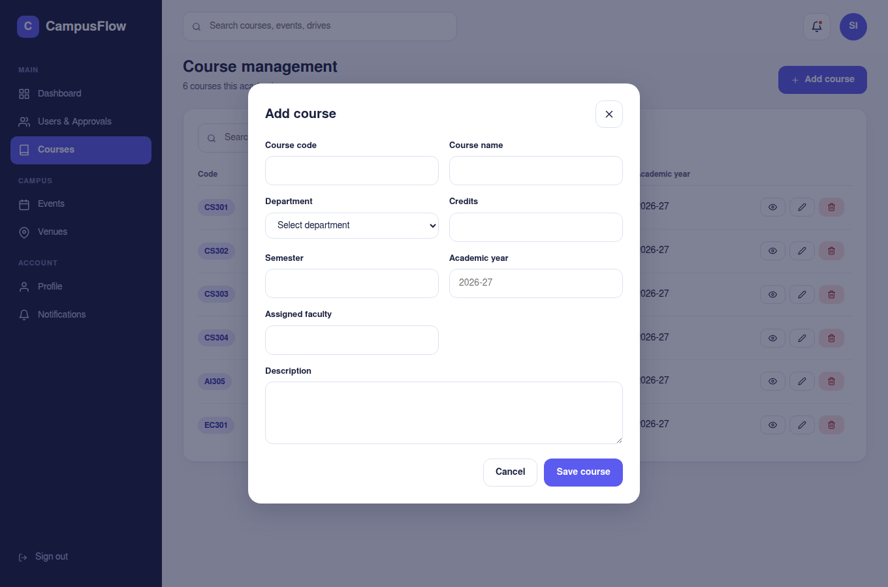

- **Route:** `/admin/courses`
- **Role:** ADMIN, FACULTY (manage mode)
- **Page file:** `frontend/src/pages/shared/Courses.jsx`
- **Data needed:**
  - `GET /api/courses`
  - `POST /api/courses`
  - `PUT /api/courses/{id}`
  - `DELETE /api/courses/{id}`
- **Behaviour:** Page file shared with the student screen; manage={true} shows Add, Edit and Delete. The screenshot shows the Add course dialog open.

### 26. Manage events (admin)

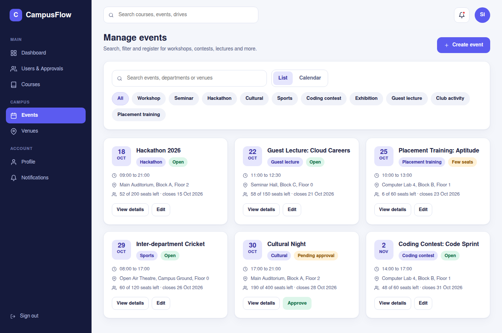

- **Route:** `/admin/events`
- **Role:** ADMIN, FACULTY (manage mode)
- **Page file:** `frontend/src/pages/shared/Events.jsx`
- **Data needed:**
  - `POST /api/events`
  - `PUT /api/events/{id}`
  - `PATCH /api/events/{id}/approve`
  - `PATCH /api/events/{id}/cancel`
- **Behaviour:** Same page file as the student events screen, rendered with manage={true}: shows Create event, Approve and Edit.

### 27. Venue management

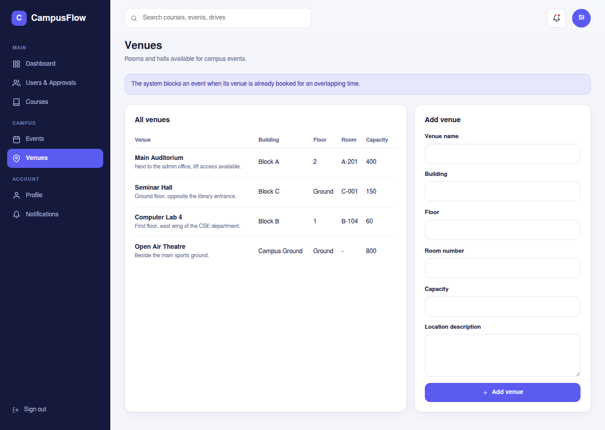

- **Route:** `/admin/venues`
- **Role:** ADMIN
- **Page file:** `frontend/src/pages/admin/Venues.jsx`
- **Data needed:**
  - `GET /api/venues`
  - `POST /api/venues`
- **Behaviour:** Backend must reject an event whose venue is already booked for an overlapping time.

### 28. Student dashboard on a phone (responsive)

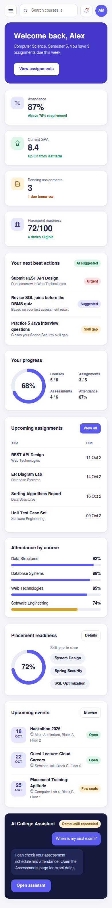

- **Route:** `/student`
- **Role:** STUDENT
- **Page file:** `frontend/src/pages/student/StudentDashboard.jsx`
- **Data needed:**
  - `Same as student dashboard`
- **Behaviour:** Responsive layout under 900px: the sidebar becomes a slide-in drawer opened from the menu button, and cards stack in one column.
